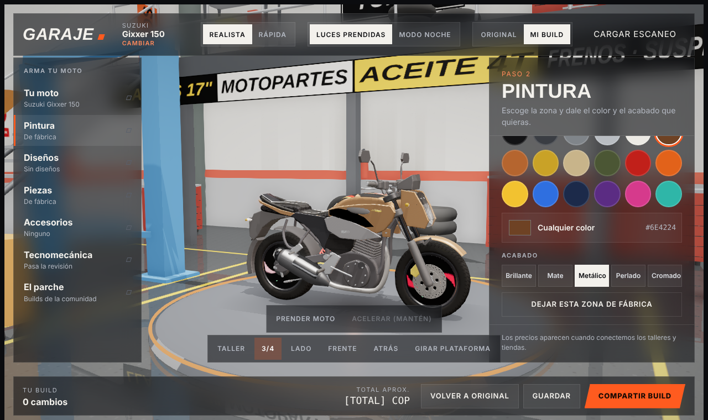
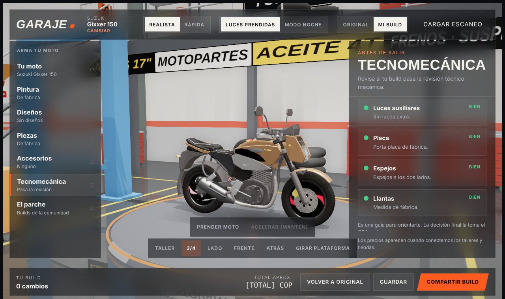
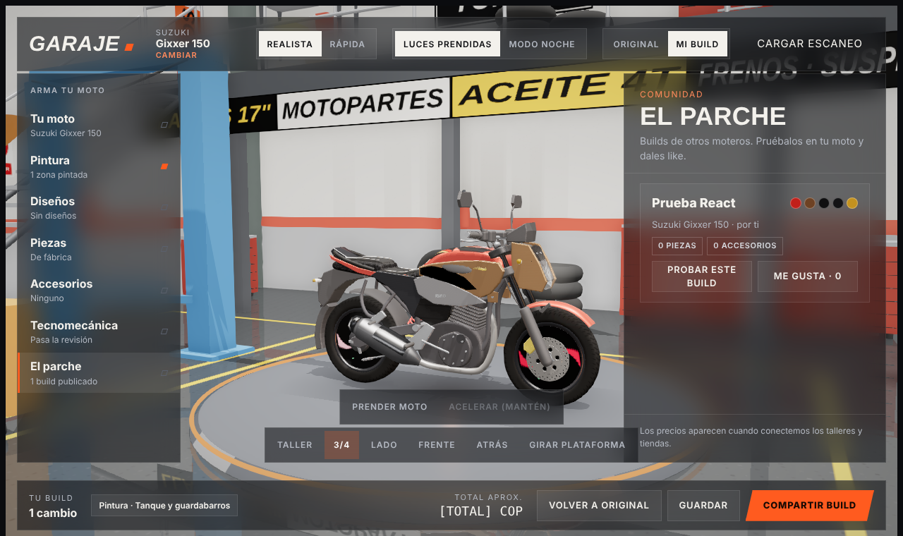

# Garaje 3D

Garaje para personalizar motos en 3D desde el navegador: pintura por zonas, diseños y calcomanías, cambio de piezas y accesorios, en un taller con iluminación realista. La idea es que cualquier persona busque su moto entre las que se venden en Colombia y la arme a su gusto, al estilo del garaje de *Need for Speed: Most Wanted*.

La moto base es mi **Suzuki Gixxer 150**, modelada por piezas en Blender para poder pintar cada zona y cambiar partes por separado.


## Capturas





## Qué hace

- **Pintura:** color por zonas (tanque, guardabarros, rines, chasis) y acabados como mate, brillante o cromado.
- **Diseños:** calcomanías y gráficos sobre la carrocería.
- **Piezas y accesorios:** cambio de partes sobre el modelo separado por piezas.
- **Taller 3D:** ambiente HDRI y vistas de cámara (taller, tres cuartos, lado, frente y atrás).
- **Cargar tu moto:** botón para subir un escaneo `.glb` propio.
- **"El parche":** comunidad para publicar builds y dar likes. Hoy funciona en el navegador (localStorage) y está lista para conectarse a un backend Node + MySQL.

## Estructura

```
garaje-3d/
├── web/            Aplicación principal en React + Vite
│   ├── src/engine/     Motor 3D (Three.js): moto, pintura, piezas, cámara, audio
│   ├── src/components/ Interfaz: barra superior, paneles, vistas, compartir
│   ├── src/services/   Comunidad "El parche" (local, con interfaz para backend)
│   └── docs/BACKEND.md Endpoints y tablas MySQL sugeridas
├── html-completo/  Primera versión en un solo archivo HTML, con sus fuentes por partes
└── modelos/        Gixxer150_piezas.glb, la moto separada por piezas
```

## Correr en local

```bash
cd web
npm install
npm run dev      # http://localhost:5173
npm run build    # genera dist/ para publicar
```

La versión de `html-completo/` se abre con doble clic en Chrome. Si el navegador bloquea algo, sirve la carpeta con `python -m http.server 8000`.

## Publicar en Vercel

La app de `web/` ya trae su `vercel.json`. Para publicarla:

1. En [vercel.com/new](https://vercel.com/new), importa el repo `garaje-3d`.
2. En **Root Directory** elige `web`. Vercel detecta Vite solo.
3. Dale **Deploy**. Cada push a `main` vuelve a publicar.

## Próximos pasos

- Escanear la Gixxer real con LiDAR para el modelo final.
- Catálogo de marcas y modelos que se venden en Colombia.
- Backend Node + MySQL para guardar builds y la comunidad.

## Créditos

El ambiente HDRI del taller (`workshop.exr`) es CC0 de [Poly Haven](https://polyhaven.com/).

---

Hecho por **Santiago Marín** · [Portafolio](https://portafolio-react-eosin.vercel.app/) · [GitHub](https://github.com/SantiMarin07)
